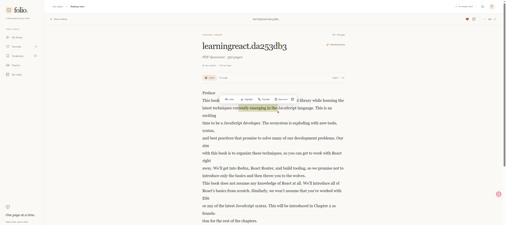

# Folio

Folio is a browser-based document reader for reading English texts and building a personal vocabulary collection. Import documents, listen to passages, annotate what you read, translate English into Vietnamese on your device, and practice the words you save.

Documents, reading progress, notes, highlights, vocabulary, and preferences are stored in your browser. The application has an English interface and does not require an account or translation API key.

## Features

- **Personal library:** Import PDF, DOCX, TXT, and Markdown files; search, filter, sort, paginate, favorite, and resume documents. Four bundled readings let you try the application immediately.
- **Reading tools:** Restore your last page, jump between pages, and adjust the font, text size, and line spacing.
- **Vietnamese typography:** Bundled Noto Serif and Noto Sans render composed and combining accents consistently. Selection, highlights, pagination, and speech keep whole letters together without rewriting saved text or annotation offsets.
- **Annotations:** Highlight passages in three colors and create, edit, search, or delete notes linked to their source pages.
- **Text to speech:** Listen to a page, an entire document, selected text, or vocabulary terms using browser speech synthesis, with pause, resume, and stop controls.
- **On-device translation:** Translate English into Vietnamese using the browser Translator API or a bundled Mozilla/Bergamot model, with download progress, cancellation, retry, and cached results.
- **Vocabulary collection:** Save words with editable meanings, context, and source links. Suggested meanings fill automatically without overwriting manual edits. Search and browse 12, 24, or 48 words per page.
- **Vocabulary export:** Download all or selected words as Excel (`.xlsx`) or PDF (`.pdf`) files generated in the browser.
- **Practice:** Review saved words with flashcards and multiple-choice quizzes built from your selected vocabulary.
- **Personalization:** Choose light, dark, or system appearance; configure reading typography, speech language, voice, speed, and translation mode.

## Screenshot



## Tech Stack

| Area | Technologies |
| --- | --- |
| Application | Next.js 16 App Router, React 19, TypeScript 5 with strict checking |
| Styling and UI | CSS, `@hangnguyen1902/theme` pinned to `0.1.0`, `lucide-react` |
| Browser storage | IndexedDB through `idb`; localStorage for the theme |
| Document extraction | `pdfjs-dist` for PDF; `mammoth` for DOCX |
| Translation | Browser Translator API; Mozilla/Bergamot WebAssembly SIMD in a Web Worker |
| Speech | Web Speech API (`speechSynthesis`) |
| Export | `write-excel-file`, `jspdf`, `jspdf-autotable`, bundled Noto Sans font |
| Verification | Node.js test runner through `tsx`, `fake-indexeddb`, Playwright |

See [package.json](package.json) for dependency ranges and [package-lock.json](package-lock.json) for resolved versions.

## Getting Started

### Requirements

- **Node.js 22.15.0 or later** and **npm**. The asset preparation script needs Node.js zstd support to decompress missing translation files.
- A browser with IndexedDB enabled. Downloaded translation requires Web Workers, WebAssembly SIMD, and a secure context such as HTTPS or localhost.
- Network access to install dependencies and, if missing or invalid, download the pinned translation assets.

### Installation

1. From the repository root, install dependencies:

   ```bash
   npm install
   ```

   The `postinstall` script copies the matching PDF.js worker into `public/` and prepares the local translation assets. Existing translation files are checked against pinned sizes and SHA-256 hashes; valid files are reused without downloading them again.

2. Start the development server:

   ```bash
   npm run dev
   ```

3. Open [http://localhost:3001](http://localhost:3001).

No `.env` file, cloud credentials, or external database setup is required.

### Production

```bash
npm run build
npm run start
```

The production server also listens on port **3001**. The build prepares assets; `start` expects an existing production build. Serve the generated `public/pdf.worker.min.mjs`, the complete `public/translation/` directory, and `public/fonts/NotoSans-Regular.ttf` with the application.

## Usage

### Build a library and read

1. Open **My library** and choose a bundled reading, upload files, or drag files onto the upload area. Supported extensions are `.pdf`, `.docx`, `.txt`, `.md`, and `.markdown`.
2. Search, filter, or sort your library; use the heart button to add a document to **Favorites**. Library and Favorites lists display 12 documents per page.
3. Open a document to read. Page navigation saves your position so you can resume later. Adjust typography in the reader or **Settings**.
4. Select text to **Listen**, **Highlight**, **Translate**, **Save word**, or add a note. Use the reader notebook to revisit notes and highlights, or **My notes** to search and manage notes across documents.
5. Use **Listen** to read the current page or whole document. Configure English or Vietnamese speech, a device voice, and playback speed in **Settings**.

Use **Edit Book Name** in the library, Favorites, or reader to rename an uploaded document. Names are trimmed and must contain 1-200 characters; vocabulary source labels and searches use the current book name. Deleting an uploaded document also removes its notes and highlights, while saved vocabulary remains.

DOCX text is extracted locally by Mammoth and retains its Unicode characters, punctuation, and paragraph breaks. TXT and Markdown support UTF-8 and BOM-marked UTF-16 LE/BE. PDF extraction preserves the spaces and line breaks supplied by PDF.js, including text runs split between a letter and its accents. Older PDF imports that already contain inserted spaces need to be imported again from the original file; existing saved content is not rewritten because doing so could change real spacing and annotation positions. Font fixes apply to existing DOCX books immediately.

The **Show default books** switch controls the visibility of bundled readings in Library and Favorites, including counts and the continue-reading card. It is enabled by default and persists across reloads. Hiding these readings preserves their progress, favorites, notes, highlights, and vocabulary, and keeps uploaded documents visible.

### Save and practice vocabulary

1. Select **Save word** while reading, or choose **Add a word** in **Vocabulary**.
2. Review the suggested Vietnamese meaning or enter your own. New terms receive suggestions after you stop typing; late translation results do not replace manual edits. Translation failure still allows you to save a manual meaning.
3. Search by term, meaning, or source title. Choose **12 / 24 / 48** under **Words per page** and use numbered pages or **Go to page** for longer collections. Searching or changing page size returns to the first page; edits and deletions keep the current page valid.
4. Open **Practice**, select words, choose **Flashcards** or **Multiple choice**, and start a session. Practice uses words with both a term and a meaning. Multiple choice needs at least two distinct meanings and offers up to four answers from the selected session.

### Export vocabulary

1. Select individual words or use **Select All**. Selection is retained across pages and searches; **Select All** includes the entire collection, including words hidden by search.
2. Choose **Export Vocabulary**, then **Export All** or **Export Selected**.
3. Choose **Excel (.xlsx)** or **PDF (.pdf)** and select **Download file**.

Exports reload saved vocabulary from IndexedDB when generated. Both formats contain exactly three columns: **STT** (sequence number), **Word / Phrase**, and **Meaning**. Rows are ordered newest first and numbered from 1 within each file. Missing values remain blank; exports do not invent meanings.

Both formats wrap long text and give the Meaning column more space. Excel preserves the original Unicode text, stores sequence numbers as numbers, and freezes the header row. PDF embeds Noto Sans, normalizes combining accents for display, paginates long content, and repeats table headers. PDF characters outside the font's coverage, such as some CJK characters or emoji, produce an error suggesting Excel.

Files are generated on your device, and the browser handles saving them. Generation or download-start errors are displayed so you can retry.

## Available Scripts

| Command | Purpose |
| --- | --- |
| `npm run dev` | Prepare assets and start the development server on port 3001. |
| `npm run build` | Prepare assets and create a production build. |
| `npm run start` | Serve an existing production build on port 3001. |
| `npm run prepare:pdf` | Copy the PDF worker from the installed `pdfjs-dist` package. |
| `npm run prepare:translation` | Verify translation assets and restore missing or invalid files from pinned sources. |
| `npm run prepare:assets` | Run both PDF and translation asset preparation. |
| `npm run postinstall` | Run asset preparation; npm also invokes this after installation. |
| `npm run test` | Run unit tests in `tests/unit/` using `tsx` and the Node.js test runner. |
| `npm run typecheck` | Run TypeScript checking without emitting JavaScript. |
| `npm run test:e2e` | Build the application and run Playwright tests. |
| `npm run check` | Run unit tests, TypeScript checking, and the production build in sequence. |

There is currently no lint script or linter configuration in the repository. `check` does not include Playwright tests or linting.

## Testing

Run the unit tests, type checking, and production build:

```bash
npm run check
```

For browser tests, install Playwright's Chromium browser and run:

```bash
npx playwright install chromium
npm run test:e2e
```

Playwright starts a production server at **http://localhost:3101**. The default configuration uses Chromium. If you already have a current production build, run `npx playwright test` directly. Regular translation UI tests mock the native Translator API to check caching, automatic meanings, unsupported-browser errors, and manual edits. Unit tests also simulate cancellation and fallback.

Real downloaded-model smoke tests are optional. After building, enable them in **PowerShell**:

```powershell
$env:FOLIO_REAL_TRANSLATION = '1'
npx playwright test tests/e2e/translation.spec.ts --grep 'real downloaded model'
npx playwright install firefox webkit
npx playwright test --config playwright.model.config.ts
Remove-Item Env:FOLIO_REAL_TRANSLATION
```

These tests exercise real inference and translation of new text while the page is offline. The additional configuration targets Firefox and WebKit. Changes to the runtime or model also need translation-quality review and testing on real Android and iOS devices; desktop WebKit testing alone does not establish iPhone compatibility.

## Project Structure

```text
app/                         App Router pages and global styles
  page.tsx                   Library route (/)
  read/[id]/page.tsx          Document reader
  favorites/                 Favorites route
  vocabulary/                Vocabulary collection route
  learn/                     Practice route
  notes/                     Notes route
  settings/                  Settings route
  layout.tsx                 Root layout, metadata, providers, and navigation shell
components/                  Views, dialogs, pagination, and shared UI
  providers.tsx              React state and persistence operations
hooks/                       Speech playback and translation request lifecycles
lib/
  database.ts                IndexedDB schema and persistence
  import-document.ts         File validation and local text extraction
  translation.ts             Browser translation, fallback, and result caching
  local-translation.ts       Downloaded-model worker client
  vocabulary-export.ts       Excel and PDF generation
  quiz.ts                    Vocabulary practice logic
  seed.ts                    Four bundled demo readings
  text.ts                    Pagination, selection, and speech text helpers
  types.ts                   Shared data types and default settings
public/
  fonts/                     Noto Sans export font and license
  translation/               Worker, runtime, model, manifest, and license
scripts/                     PDF worker preparation and pinned translation assets
tests/unit/                  Logic, persistence, translation, and export tests
tests/e2e/                   Browser workflows and optional real-model smoke tests
types/                       Additional library type declarations
playwright.config.ts         Chromium browser-test and server configuration
playwright.model.config.ts   Firefox and WebKit model smoke-test configuration
```

The App Router provides the pages and shared shell. Client views access state through `components/providers.tsx`, which persists changes through `lib/database.ts`. Document extraction, speech, translation inference, and vocabulary export run in the browser; there is no application translation API route or cloud translation fallback.

## Configuration and Data

### Translation modes and assets

Choose a mode in **Settings**:

| Mode | Behavior |
| --- | --- |
| **Automatic** | Try the browser's on-device English-Vietnamese translator, then fall back to the downloaded model if unavailable or unsuccessful. |
| **Browser translator** | Use only the native Translator API; report an error if the API or language pair is unavailable. |
| **Downloaded model** | Use the same-origin Mozilla/Bergamot model in a Web Worker. |

Native support and English-Vietnamese availability are checked at runtime. Browser language packs are downloaded and managed by the browser; initialization is triggered from user interactions. Previously saved cloud-provider preferences migrate to Automatic, preserving reading data. Old cloud translation cache entries are not reused.

The downloaded engine uses Mozilla's `base-memory` English-Vietnamese model. Model weights are approximately **31.6 MB**; the complete model, runtime, and supporting assets total approximately **42 MB uncompressed**. The first use downloads these files from the application itself. Text is processed on the device, with no inference request sent to a translation service. Translation results are cached separately by engine, version, and input text in IndexedDB.

Model files use browser Cache Storage when available. Cache failures do not prevent translation, and result-cache failures do not discard successful results. Closing a translation dialog or changing the term discards stale results; cancelling active local inference terminates its worker. A loaded page can keep translating offline after the assets have been cached, including restarting its worker. Offline loading of the entire application is not provided.

The [asset lock](scripts/translation-assets.lock.json) records versions, source URLs, sizes, and SHA-256 hashes. Restore missing or invalid assets with:

```bash
npm run prepare:translation
```

To verify existing assets without downloading files:

```bash
node scripts/prepare-translation.mjs --verify
```

When updating a model, keep the asset lock, manifest hash, worker version, result-cache version, and matching JavaScript/WASM runtime in sync, then rerun the real-model tests. See [translation asset documentation](public/translation/README.md) for pinned sources and engine details.

If you configure a Content Security Policy, allow same-origin asset fetches, `worker-src blob:`, and `script-src blob:` for the verified runtime loaded inside the worker, as described in that document.

### Browser storage

Folio uses the IndexedDB database **`folio-reading`**, schema version **1**:

| Store | Contents |
| --- | --- |
| `documents` | Extracted pages, metadata, favorites, and reading position |
| `highlights` | Source document/page, text offsets, text, and color |
| `notes` | Source document/page, quotation, and note body |
| `vocabulary` | Terms, meanings, context, and source references |
| `settings` | Reader preferences under the `preferences` key |
| `translations` | Translation results keyed by engine, version, and text |

The theme is stored separately in localStorage under **`folio-theme`**. Saves are confirmed after browser storage operations succeed. Data belongs to the current browser profile and origin, including the port; there is no cloud synchronization. Clearing site data removes saved information, and cached assets may be evicted by the browser.

### Test environment

`FOLIO_REAL_TRANSLATION=1` opts into real-model smoke tests. Playwright uses `CI` to enable one retry, reject focused tests, and avoid reusing an existing server. Neither variable is required to run the application.

## Limitations

- Imports accept files up to **20 MiB** (shown as 20 MB in the UI) and **1,000,000 extracted characters**. PDF extraction processes every page without a separate page-count limit.
- PDF and DOCX imports extract text; original layouts and images are not preserved. Markdown is displayed as plain text.
- Scanned PDFs without selectable text require external OCR. Password-protected PDFs require an unlocked copy.
- Translation supports **English to Vietnamese** only and accepts **1-5,000 characters** per request. Longer selections are rejected rather than truncated. Machine-generated meanings are editable suggestions that need review, especially for ambiguous words and specialist terms.
- Downloaded translation requires WebAssembly SIMD, and its speed and memory usage depend on the device. Manual vocabulary entry remains available if translation fails.
- Speech depends on browser support and installed voices. Some system voices require a network connection; the on-device translation behavior does not guarantee offline speech.
- The application does not provide cloud synchronization or a PWA/service worker for fully offline startup.

## Troubleshooting

| Problem | What to check |
| --- | --- |
| Translation asset preparation fails | Check Node.js is at least 22.15.0 and the pinned download sources are reachable, then rerun `npm run prepare:translation`. Use `node scripts/prepare-translation.mjs --verify` to check existing assets. |
| PDF import cannot load its worker | Run `npm run prepare:pdf` and ensure `/pdf.worker.min.mjs` is served by the application. |
| A PDF has no readable text or asks for a password | Use an OCR-processed or unlocked copy containing selectable text. |
| Browser translator is unavailable | Choose **Automatic** or **Downloaded model** in Settings; native support depends on the API, language pair, and secure context. |
| Downloaded translation fails or times out | Check HTTPS/localhost, WebAssembly SIMD support, access to `/translation/` files, and any custom CSP. Retry with a shorter passage or enter a meaning manually. |
| Reading data cannot be saved | Enable site storage and check available browser storage, then retry. Use the same browser profile and origin to access existing data. |
| Speech is unavailable | Check browser speech synthesis support and select an installed voice in Settings. An online voice may need a connection. |
| PDF vocabulary export fails | Ensure `/fonts/NotoSans-Regular.ttf` is served. For unsupported characters, select Excel to preserve the text. |
| Playwright cannot launch a browser or find a build | Run `npx playwright install chromium` and use `npm run test:e2e`, which creates the required production build. |

## License and Third-Party Notices

No project-wide license is specified in this repository.

- Mozilla translation assets and the worker adapter are documented under **MPL 2.0**. See the [translation notices and corresponding source](public/translation/README.md) and [included license](public/translation/mozilla-envi-v1/LICENSE).
- The bundled Noto Sans font uses the **SIL Open Font License 1.1**. See the [font documentation](public/fonts/README.md) and [included license](public/fonts/OFL.txt).

Keep the relevant third-party notices when redistributing these assets. The bundled readings were written for the demo.
